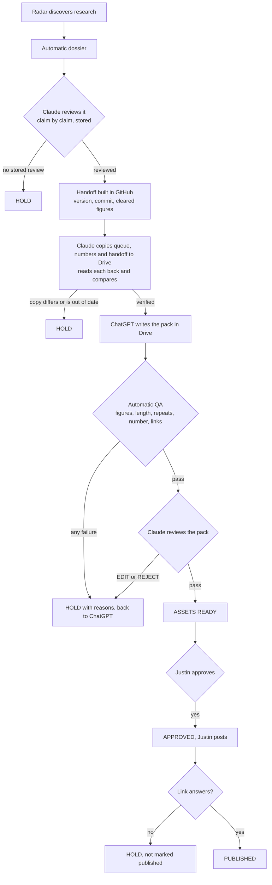

# Research Radar: how Claude and ChatGPT work as one pipeline

Read this before running any part of it. `PROBE.md` beside it covers what the
radar can and cannot reach on the web.

## The honest status line

**The gates are automated and tested. The joins between the two AIs are not
automatic.** Three things still need a person or a Claude session:

1. **Copying anything to Drive is a Claude step.** A Node script cannot reach
   the Drive connector. A session prepares the snapshot, writes it, reads it
   back and compares. Nothing counts as synced until that comparison passes.
2. **ChatGPT cannot see GitHub and Claude cannot start ChatGPT.** ChatGPT reads
   the stamped copies in Drive, when Justin asks it or its own schedule fires.
3. **Approval, posting and the link are Justin's.** On purpose.

## Who owns what

| | owns | never does |
|---|---|---|
| **GitHub** | post numbers (`content/gdc-post-register.md`), every version of every research record (`content/research-register/studies.jsonl`), publication status | |
| **Drive** | stamped copies of the queue, the numbers and each handoff, and the packs ChatGPT writes | claim a post number |
| **Claude** | discovery, the dossier, the claim by claim review, the handoff, the QA pass, the pack review, the copy to Drive | approve, post, mark posted without a link |
| **ChatGPT** | the production pack, from the handoff | claim a number, add a figure, mark anything approved |
| **Justin** | approval, posting, the link, moving a register row to POSTED | |

## The flow



## The daily run, in order

```
node scripts/radar/pipeline.mjs preflight            # HOLD here means stop and fix first
node scripts/radar/pipeline.mjs handoff <researchId> # for each newly reviewed story
node scripts/radar/sync.mjs prepare manifest "" out.json       # then write to Drive, read back
node scripts/radar/sync.mjs prepare postRegister "" out.json   # same
node scripts/radar/sync.mjs prepare handoff <researchId> out.json
node scripts/radar/packformat.mjs > start-here.txt   # the one doc ChatGPT opens first
node scripts/radar/sync.mjs state                    # what Drive holds and whether it is in step
npm run radar-dashboard                              # rebuild the Radar Desk
```

Copying to Drive, for the session doing it:

1. `prepare` writes the exact bytes and prints the title to use.
2. Create the file in the Stage 2 folder with conversion to a Google type
   switched off, so the stored bytes are the sent bytes.
3. Download it again (the download call, not the read call: the read call
   renders markdown and adds escaping), pull the bytes out of the transcript
   with `drive-bytes.py`, and pass both to `acceptSnapshot`. Never compare by
   eye or retype base64: that was tried on 10 November and was wrong three
   times running. For a Google Doc, download its plain text export and use
   `verifyDocExport`, which compares the whole text.
4. Retitle the copy it replaces `ZZ SUPERSEDED ...`. One current file per role.

When a pack comes back from ChatGPT:

1. Read the pack Doc from Drive and save its text to a file. `drive-text.py`
   pulls exactly what the read returned out of the session transcript, and
   `drive-bytes.py` does the same for a download, so nothing is retyped.
2. `parsePackText` (in `packformat.mjs`) turns it into a pack object.
3. `node scripts/radar/pipeline.mjs submit pack.json` runs the QA pass. A HOLD
   prints every reason. Write those back to Drive for ChatGPT and stop.
4. On a PASS, review the pack and store that review with `reviewPack`.
5. `node scripts/radar/pipeline.mjs ready <researchId>` moves it to ASSETS
   READY only if QA passed, the review passed and the Drive save verified.

## What a HOLD means

Every gate returns PASS or HOLD with reasons, and writes the result onto the
record as `gate`, which is what the dashboard's Blocked section shows. A HOLD
from a gate does **not** change the record's status. Status `HOLD` in the
register means deliberately parked and takes a story out of the queue; a pack
that failed QA is waiting for a fix and stays where Stage 2 can see it.

## Stale, and what it does not mean

A Drive copy is stale when the **facts** in it have changed, not when the repo
has a new commit. Each snapshot carries a facts digest that ignores timestamps,
and for the queue also ignores register totals and version counters. So a
discovery run that adds unchecked research does not hold Stage 2, and a change
to what is in the queue does.

## Tests

```
npm run radar-pipeline-test   # 114 checks, throwaway register, the seven failures simulated
npm run radar-drop-test       # the two full text lanes
```

Both run against a temporary register and never write to the real one. The
pipeline test ends by comparing digests of the live register, its history and
the post register from before and after.

The seven failures simulated, each of which must end in a HOLD: missing
repository access, stale manifest, duplicate story, failed Drive save,
conflicting post number, missing Claude review, failed editorial QA.

## Known limits

- **Tested for real on 10 November:** write to Drive and read back, byte
  identical, for the queue, the number list and the handoff; the start here
  Doc, text identical; and a labelled test pack written as a Google Doc, read
  back, parsed and passed through QA, then removed.
- **Whether ChatGPT can read each Drive file has not been tested from here.**
  Claude cannot run ChatGPT. The start here document is a Google Doc for that
  reason; the JSON copies are for verification and for Claude.
- The QA pass checks a pack against the handoff and the house rules. It cannot
  tell whether a claim is true, cannot see an image and cannot read LinkedIn.
- A LinkedIn link that answers proves the URL exists. It does not prove the
  post is ours or says what was approved.
- There is no Story Bible in Drive. Nothing should be told to read one.
