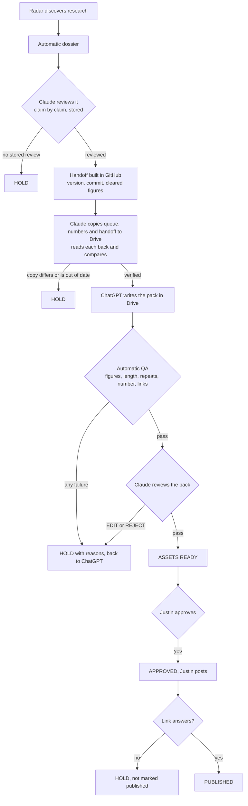

# Research Radar: how Claude and ChatGPT work as one pipeline

Read this before running any part of it. `PROBE.md` beside it covers what the
radar can and cannot reach on the web.

## The honest status line

**Every gate is automated and tested. The relay between the two AIs is a
schedule of four runs, two of them Claude's. Two things are not automatic and
are not meant to be.**

What runs without anybody carrying anything, as of 10 November 2026:

| When (London) | Who | What |
|---|---|---|
| 08:00 daily | ChatGPT scheduled task | writes its brief, and one `CANDIDATES` document into the Drive inbox |
| 09:17 weekdays | Claude Code scheduled task, in the cloud | reads the inbox, checks and reviews, claims numbers, builds handoffs, copies the queue to Drive and verifies it, checks any pack that has come back |
| 11:00 daily | ChatGPT scheduled task | reads the start here document, writes one pack per cleared story |
| 12:23 weekdays | Claude Code scheduled task, **created and switched off** | checks and reviews those packs the same day. It could not be given the Drive connector from a session, so it stays off until Justin adds Google Drive to it on the routines page. Until then the 09:17 run checks packs the next morning |
| 10:43 UTC weekdays | GitHub Actions | goes red if the morning run left no log, or logged a HOLD or an ERROR |

What ChatGPT's two tasks must be told is in
`scripts/radar/routines/chatgpt-prompts.md`. Justin pastes it once. The steps of
the two Claude runs are in `scripts/radar/routines/`.

What is still a person, on purpose:

1. **Approval, posting and the link are Justin's.** Nothing here can do them.
2. **Merging the day's pull request.** Each Claude run pushes a branch and opens
   a pull request. Until it is merged, main does not agree with Drive. The gate
   in GitHub Actions checks it; merging it is Justin's click unless he asks for
   the gate to merge it.

What is not proven, said plainly:

- **ChatGPT has not yet written a candidate document.** It has written a file to
  Drive every day since at least 30 October, including raw `.md` files, so the
  write is known to work. Whether its scheduled task produces valid JSON in the
  inbox is unproven until its 08:00 prompt is changed and it runs once.
- **The Claude scheduled task is a research preview feature.** It has run every
  weekday morning, and the documentation promises no retry and no failure
  notice. That is what the GitHub watchdog is for.
- Copying to Drive is still a Claude step. A Node script cannot reach the Drive
  connector, in a session or in GitHub Actions.

## Who owns what

| | owns | never does |
|---|---|---|
| **GitHub** | post numbers (`content/gdc-post-register.md`), every version of every research record (`content/research-register/studies.jsonl`), publication status | |
| **Drive** | stamped copies of the queue, the numbers and each handoff, and the packs ChatGPT writes | claim a post number |
| **Claude** | discovery, the dossier, the claim by claim review, the handoff, the QA pass, the pack review, the copy to Drive | approve, post, mark posted without a link |
| **ChatGPT** | the production pack, from the handoff | claim a number, add a figure, mark anything approved |
| **Justin** | approval, posting, the link, moving a register row to POSTED | |

## The flow



## The daily run, in order

```
node scripts/radar/daily.mjs morning --inbox <dir> --posting-pack <file>
                                   # preflight, inbox, discover, dossier, who is waiting
node scripts/radar/pipeline.mjs review <researchId>   # after writing reviews/<id>.json
node scripts/radar/daily.mjs handoffs                 # number, handoff and queue, idempotent
node scripts/radar/sync.mjs prepare manifest "" out.json       # then write to Drive, read back
node scripts/radar/sync.mjs prepare postRegister "" out.json   # same
node scripts/radar/sync.mjs prepare handoff <researchId> out.json
node scripts/radar/packformat.mjs > start-here.txt   # the one doc ChatGPT opens first
node scripts/radar/daily.mjs packs <dir>              # QA over every pack text handed to it
node scripts/radar/approval.mjs approval.txt          # the one sheet behind the Post Desk
node scripts/radar/daily.mjs log "DRIVE SYNC" PASS "..."   # the steps only Claude can do
node scripts/radar/daily.mjs summary                  # what Justin reads
node scripts/radar/gate.mjs                           # integrity of what is about to be pushed
npm run radar-dashboard                               # rebuild the Radar Desk
```

Every stage writes PASS, HOLD, WAITING, SKIPPED or ERROR to
`content/research-register/runs/<date>.json`. A stage that did not run shows as
NOT RUN in the summary, which is different from finding nothing.

## The candidate inbox

Folder: `DRIVE.CANDIDATE_INBOX` in `contract.mjs`, inside the Stage 2 folder.
ChatGPT saves one document a day, in the shape of
`scripts/radar/candidate.schema.json`. A `.json` file, a `.md` file or a Google
Doc with the JSON inside are all read.

- A candidate is a pointer and a set of claims to check. It enters the register
  as DISCOVERED, with its claims stored under `candidate` and marked UNVERIFIED.
  Nothing in it can be quoted. The dossier and the directed review run on it
  like any other record.
- Ingest is idempotent. `content/research-register/inbox-ledger.json` is keyed
  by the digest of the document and by batch and candidate id.
- Deduplication runs against the research register, the post register, the
  archived and published posts, and ChatGPT's posting pack when the run has
  read it.
- A candidate with no original link, no publication date, no claims or no
  stated limits is HELD, and the reason is written into the start here
  document, which is the only channel back to ChatGPT.
- "Official" is the sender's word. A public body's page is only confirmed on a
  host listed in `dossier.mjs`, once it answers and carries the title and date.
- A document that has been read is retitled `ZZ INGESTED`. Never deleted.

## The four statuses Justin sees

| On the approval desk | In the register |
|---|---|
| READY FOR JUSTIN | ASSETS READY |
| CHANGES REQUESTED | ASSETS READY, with an open `founderDecision` |
| APPROVED | APPROVED |
| PUBLISHED | PUBLISHED |

`requestChanges`, `approve` and `publish` in `pipeline.mjs` are the only way
between them, and the first two accept only Justin, with his words. A pack he
sent back cannot be approved, and cannot return to ready, until a version
submitted after he asked has been through QA, review and a verified save.

Copying to Drive, for the session doing it:

1. `prepare` writes the exact bytes and prints the title to use.
2. Create the file in the Stage 2 folder with conversion to a Google type
   switched off, so the stored bytes are the sent bytes.
3. Download it again (the download call, not the read call: the read call
   renders markdown and adds escaping), pull the bytes out of the transcript
   with `drive-bytes.py`, and pass both to `acceptSnapshot`. Never compare by
   eye or retype base64: that was tried on 10 November and was wrong three
   times running. For a Google Doc, download its plain text export and use
   `verifyDocExport`, which compares the whole text.
4. Retitle the copy it replaces `ZZ SUPERSEDED ...`. One current file per role.

When a pack comes back from ChatGPT:

1. Read the pack Doc from Drive and save its text to a file. `drive-text.py`
   pulls exactly what the read returned out of the session transcript, and
   `drive-bytes.py` does the same for a download, so nothing is retyped.
2. `parsePackText` (in `packformat.mjs`) turns it into a pack object.
3. `node scripts/radar/pipeline.mjs submit pack.json` runs the QA pass. A HOLD
   prints every reason. Write those back to Drive for ChatGPT and stop.
4. On a PASS, review the pack and store that review with `reviewPack`.
5. `node scripts/radar/pipeline.mjs ready <researchId>` moves it to ASSETS
   READY only if QA passed, the review passed and the Drive save verified.

Both helper scripts take `auto` as the transcript, meaning the session that is
running:

```
python3 scripts/radar/drive-bytes.py auto <fileId> out.bin      # after a download
python3 scripts/radar/drive-text.py  auto "<title phrase>" out.txt  # after a read
```

## One register, never two

On 10 November the 09:17 routine built a 25 record register in its own session
and uploaded a queue to Drive from it. None of that reached main, so the next
session started from 16 records and the repo file said 14. Three answers to one
question. The rule that stops it:

- If an open pull request already touches `content/research-register/`, carry
  on from that branch. Do not start a second register from main.
- Push the branch and open the pull request BEFORE copying anything to Drive,
  so every Drive copy is stamped with a commit that exists in GitHub.
- Say in the hand over that the pull request needs merging. Until it is merged
  main does not agree with Drive.

## Who fixes a pack that is not right

Two different kinds of problem, two different answers. Settled on 10 November
on the first real pack, GDC-054.

- **A breach of the handoff goes back to ChatGPT.** A figure that was not
  cleared, a prohibited claim, a wrong or invented post number, a pack written
  from an old handoff version, a causal claim. Claude does not repair these,
  because a quiet repair hides that Stage 2 misread the handoff. The reasons
  go in the start here document and ChatGPT writes the next version.
- **Voice and house style are edited by Claude.** Rhythm, the shapes the
  ai-tells guard cannot see, the proof path, the repost ask, the closing
  question, a missing "the source is in the comments". This is the standing
  rule in `.claude/skills/content-engine/drive-post-review.md`: every post in
  Drive gets a Claude review and, where it is a fix, a rewrite. The edit is
  saved as the next version, titled `... DRAFT v2, Claude edit of v1`, the
  original is kept and retitled, and it goes through the same QA.

When Claude has edited a pack, the stored review says so in plain words: the
editor and the reviewer are the same, the mechanical checks are independent,
and whether it sounds like Justin is his to judge. The Post Desk card carries
the same sentence.

A pack reaches the Post Desk only at ASSETS READY. Putting it there is not
approval. Approval is Justin posting it.

## What a HOLD means

Every gate returns PASS or HOLD with reasons, and writes the result onto the
record as `gate`, which is what the dashboard's Blocked section shows. A HOLD
from a gate does **not** change the record's status. Status `HOLD` in the
register means deliberately parked and takes a story out of the queue; a pack
that failed QA is waiting for a fix and stays where Stage 2 can see it.

## Stale, and what it does not mean

A Drive copy is stale when the **facts** in it have changed, not when the repo
has a new commit. Each snapshot carries a facts digest that ignores timestamps,
and for the queue also ignores register totals and version counters. So a
discovery run that adds unchecked research does not hold Stage 2, and a change
to what is in the queue does.

## Tests

```
npm run radar-pipeline-test   # 133 checks, throwaway register, the seven failures simulated
npm run radar-relay-test      # 86 checks: a candidate from the inbox to PUBLISHED
npm run radar-drop-test       # the two full text lanes
npm run radar-gate            # 15 integrity rules over what is committed
```

The three test suites run against a temporary register and never write to the
real one. The pipeline and relay tests end by comparing digests of the live
register, its history and the post register from before and after. In the relay
test the candidate document and the production response are simulated, and say
so: ChatGPT cannot be started from a script.

`.github/workflows/radar-gate.yml` runs the pipeline test, the relay test and
the gate on every pull request that touches the radar. It needs no secret.

The seven failures simulated, each of which must end in a HOLD: missing
repository access, stale manifest, duplicate story, failed Drive save,
conflicting post number, missing Claude review, failed editorial QA.

## Running Claude somewhere else, costed and not switched on

Investigated on 10 November 2026 against the published documentation.

- **Where it runs now.** A Claude Code scheduled task in the cloud. Included in
  the subscription, uses its usage allowance, has the Drive connector, can push
  and open a pull request. Labelled research preview. No documented retry or
  failure notice. Minimum interval one hour.
- **GitHub Actions with Claude inside.** Supported, on a `schedule:` cron, with
  `anthropics/claude-code-action` or `claude -p`. It needs either an API key,
  billed per token, or a subscription token from `claude setup-token`. Neither
  can use the claude.ai Drive connector, so Drive would need its own Google
  credential held as a GitHub secret. GitHub documents that scheduled jobs can
  be delayed or dropped under load.
- **Rough API cost** for a run reading 150,000 tokens and writing 20,000, at
  list price with no caching: about 0.50 US dollars on the mid tier model and
  about 2 on the top one. At two runs a weekday that is roughly 22 or 88
  dollars a month.
- **Decision left to Justin.** It adds a bill and two secrets and removes
  nothing that is failing today, so it was not enabled. The repository already
  has two workflows that read `ANTHROPIC_API_KEY`, so the key may already exist.

## Known limits

- **Tested for real on 10 November:** write to Drive and read back, byte
  identical, for the queue, the number list and the handoff; the start here
  Doc, text identical; and a labelled test pack written as a Google Doc, read
  back, parsed and passed through QA, then removed.
- **The inbox was tested for real on 10 November** with a batch written by
  Claude and marked as such: written to the inbox, read back byte identical,
  ingested. One candidate, the European Commission's preliminary finding on
  TikTok, taken from ChatGPT's own brief of that day, went on to be confirmed
  against the Commission's page, reviewed, numbered GDC-058 and queued. A
  repeat was recognised and a broken entry was held.
- **ChatGPT's side worked on its first real run, 10 November.** It read the
  start here document, wrote GDC-054 in the right layout, and saved it in the
  right folder under the right title. One run is one run: it is not yet proven
  on a story with no post number, or on a HOLD coming back.
- The QA pass checks a pack against the handoff and the house rules. It cannot
  tell whether a claim is true, cannot see an image and cannot read LinkedIn.
- A LinkedIn link that answers proves the URL exists. It does not prove the
  post is ours or says what was approved.
- There is no Story Bible in Drive. Nothing should be told to read one.
